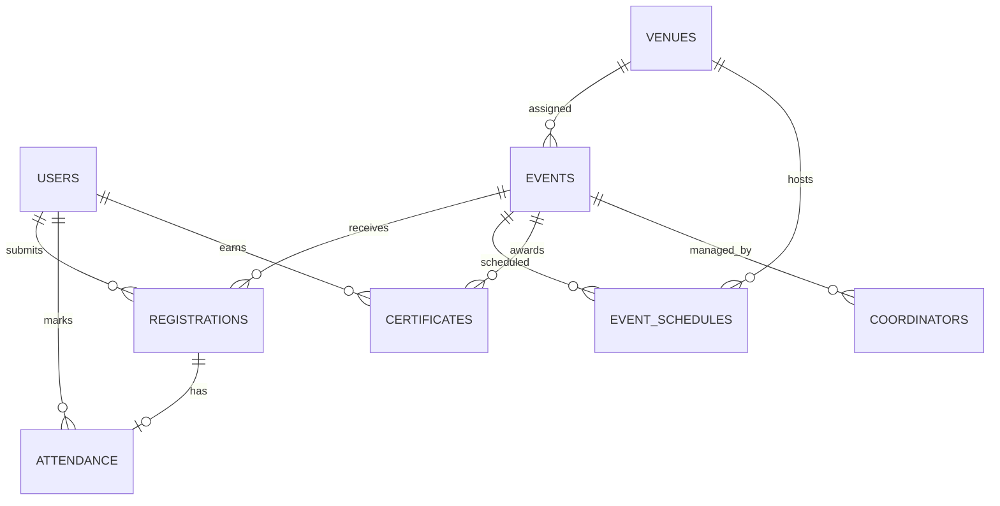

# EventSphere – DBMS Mini-Project Report Source

## Project Identification

- **Title:** EventSphere – College Event Planning and Participant Management System
- **College topic:** 23
- **Database:** MySQL 8 (`eventsphere_db`)
- **Application:** Next.js 16, React 19, TypeScript, Drizzle ORM, `mysql2`

## Abstract

EventSphere is a database-driven web application for planning college events and managing participants. Students can authenticate, browse events, register, review their registration history, cancel registrations, and download confirmation details. Administrators can authenticate separately, manage events and venues, allocate dated time slots, prevent venue conflicts, review participants, approve or reject registrations, record attendance, and view live dashboard statistics. MySQL transactions and row locking protect event capacity. Foreign keys maintain relationships, unique constraints prevent duplicate registrations and attendance records, and triggers reject overlapping venue bookings.

## Objectives

1. Maintain centralized, normalized event, participant, venue, schedule, registration, and attendance data.
2. Provide role-based student and administrator access.
3. Support complete event and venue management through a responsive web interface.
4. Prevent duplicate registrations and registrations beyond available capacity.
5. Prevent two events from using the same venue during overlapping time ranges.
6. Record event-wise attendance without duplicate attendance rows.
7. Produce live participant, registration, venue, and attendance statistics.

## Existing and Proposed Systems

### Existing system

Manual spreadsheets and paper forms commonly separate participant lists, schedules, venues, and attendance. This causes duplicated data, slow status updates, accidental double-booking, and difficulty producing reports. The original portal also depended on PostgreSQL-specific code while its documentation claimed MySQL, and it did not enforce capacity transactionally.

### Proposed system

EventSphere uses one MySQL 8 database and a Next.js application. All operational screens read current MySQL data. Role checks protect administration operations. Transactions lock event rows while registering participants. Database constraints and triggers provide protection even when writes occur concurrently or outside the UI.

## System Architecture

```text
Browser
  │ HTTPS / forms / JSON
  ▼
Next.js App Router
  ├── React server-rendered pages
  ├── Server actions
  ├── Authenticated REST route handlers
  ├── Validation and transaction services
  ▼
Drizzle ORM + mysql2 connection pool
  ▼
MySQL 8: eventsphere_db
  ├── Tables, primary/foreign keys and indexes
  ├── Transactional row locks
  ├── Reporting view
  └── Venue-overlap triggers
```

Passwords are stored as salted PBKDF2 hashes. Sessions are signed and stored in HTTP-only, same-site cookies. Authorization is rechecked on every protected server action and API route.

## Functional Modules

### Authentication

- Separate student and administrator login roles.
- Salted PBKDF2 password verification.
- Signed HTTP-only session cookies.
- Email-verification check and role-based dashboard routing.

### Event management

- Public event listing and filtering.
- Administrator event creation, editing, deletion, and listing.
- Server-side validation of required fields, dates, capacity, and status.

### Registration and participants

- Student registration and registration history.
- Unique `(user_id, event_id)` registration constraint.
- `SELECT ... FOR UPDATE` locks the event row during registration.
- Capacity decreases on registration and is restored on cancellation/rejection.
- Participant search by name, email, register number, or department.

### Venue and scheduling

- Administrator venue creation, editing, deletion, and listing.
- Venue status and capacity management.
- Event/date/start/end allocation through `event_schedules`.
- Insert and update triggers reject overlapping bookings for the same venue/date.
- Trigger failures become clear HTTP `409` and dashboard conflict messages.

### Attendance and dashboard

- Administrators mark approved participants present or absent.
- Unique `registration_id` prevents duplicate attendance records.
- Repeated marking updates the existing attendance row.
- Event-wise marked, present, and absent summaries.
- Live statistics for students, events, venues, registrations, approvals, and attendance.

## MySQL Database Design

| Table | Purpose | Important keys and constraints |
|---|---|---|
| `users` | Student/admin profiles and authentication | PK `id`; unique `email`, `register_number`; indexed `role` |
| `venues` | Allocatable campus locations | PK `id`; unique `name`; positive capacity check |
| `events` | Event master data | PK `id`; FK `venue_id`; unique `slug`; date/status/category indexes |
| `event_schedules` | Event venue/time allocations | PK `id`; FKs to events/venues; indexed venue/date/time range |
| `registrations` | Student participation workflow | PK `id`; FKs to users/events; unique user/event and confirmation code |
| `attendance` | Present/absent result | PK `id`; unique FK `registration_id`; FK `marked_by` |
| `announcements` | Dashboard notices | PK `id`; audience and priority values |
| `certificates` | Issued certificate metadata | PK `id`; FKs to users/events; unique certificate number |
| `coordinators` | Faculty/student coordinators | PK `id`; optional FK to events |

The `event_registration_summary` view combines event details with total and approved registration counts. The `prevent_venue_schedule_overlap` and `prevent_venue_schedule_overlap_update` triggers use interval intersection logic:

```sql
NEW.start_time < existing.end_time
AND NEW.end_time > existing.start_time
```

## ER Diagram



## Normalization

### First Normal Form (1NF)

Every column contains one atomic value. Repeating participants, schedules, venues, and attendance values are stored as separate rows rather than lists inside an event.

### Second Normal Form (2NF)

Non-key data depends on the whole candidate key. Registration status and confirmation code depend on one registration, while event details remain in `events` and user details remain in `users`.

### Third Normal Form (3NF)

Venue location/capacity are stored only in `venues`; participant profile fields are stored only in `users`; and attendance status is stored only in `attendance`. Foreign keys reference these facts instead of duplicating them. The legacy event venue name is retained for display compatibility, while `venue_id` is the relational allocation reference.

## Advanced SQL Concepts

### Join for participant roster

```sql
SELECT e.name, u.full_name, u.register_number, r.status, a.status AS attendance
FROM registrations r
JOIN users u ON u.id = r.user_id
JOIN events e ON e.id = r.event_id
LEFT JOIN attendance a ON a.registration_id = r.id
ORDER BY e.event_date, u.full_name;
```

### Subquery for above-average participation

```sql
SELECT e.id, e.name
FROM events e
WHERE (SELECT COUNT(*) FROM registrations r WHERE r.event_id = e.id) >
      (SELECT AVG(total) FROM
         (SELECT COUNT(*) AS total FROM registrations GROUP BY event_id) x);
```

### Transaction and locking

```sql
START TRANSACTION;
SELECT available_seats FROM events WHERE id = ? FOR UPDATE;
INSERT INTO registrations (...);
UPDATE events SET available_seats = available_seats - 1 WHERE id = ?;
COMMIT;
```

### Attendance upsert

```sql
INSERT INTO attendance (id, registration_id, marked_by, status)
VALUES (?, ?, ?, ?)
ON DUPLICATE KEY UPDATE
  marked_by = VALUES(marked_by),
  status = VALUES(status),
  marked_at = CURRENT_TIMESTAMP;
```

### Indexes

Indexes cover user roles, event date/status and category, venue/date/time slots, registration event/status, unique user/event registration, confirmation codes, emails, register numbers, venue names, and attendance registration IDs.

## Verified Test Results

Tests executed against local MySQL 8 and the running Next.js application on 11 October 2026:

| Test | Result |
|---|---|
| MySQL initialization and repeatable seed | Passed |
| 9 tables, 10 foreign keys, reporting view | Passed |
| Insert and update overlap triggers present | Passed |
| Trigger rejects overlapping venue allocation | Passed (`HTTP 409`) |
| Student venue modification authorization | Passed (`HTTP 403`) |
| Admin venue creation and deletion | Passed |
| Admin event creation/update/deletion | Passed |
| Duplicate student registration | Passed (`HTTP 409`) |
| Capacity-zero registration | Passed (`HTTP 409`) |
| Attendance restricted to admins | Passed (`HTTP 403`) |
| Attendance absent-to-present persistence | Passed |
| Duplicate attendance prevention/upsert | Passed (one row) |
| Validation unit tests | Passed (4/4) |
| TypeScript check | Passed |
| Production build | Passed |
| ESLint | Passed with zero errors; four image optimization warnings |

## Screenshot Checklist

Capture these screens with no credentials visible:

1. EventSphere home page and public event list.
2. Student login and student dashboard.
3. Student registration history after registering for an event.
4. Admin dashboard statistic cards.
5. Event creation/editing section.
6. Venue management section.
7. Schedule allocation table.
8. Visible overlap-conflict message after attempting a conflicting schedule.
9. Participant search result.
10. Registration approval and attendance controls.
11. Event-wise attendance summary cards.
12. MySQL Workbench schema/table list, ER diagram, view, triggers, and a sample join query result.

## Conclusion

EventSphere demonstrates a working multi-user DBMS application rather than a static prototype. MySQL manages normalized relational data, referential integrity, uniqueness, indexing, views, triggers, and transactional capacity control. The Next.js application exposes these capabilities through authenticated student and administrator workflows, live dashboards, venue conflict prevention, participant management, and persistent attendance tracking.
